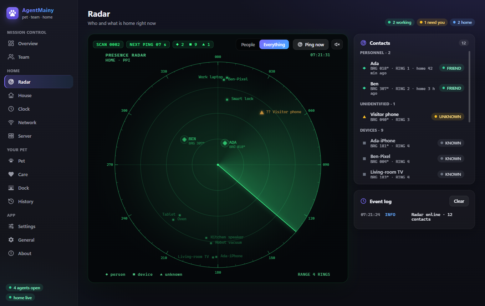
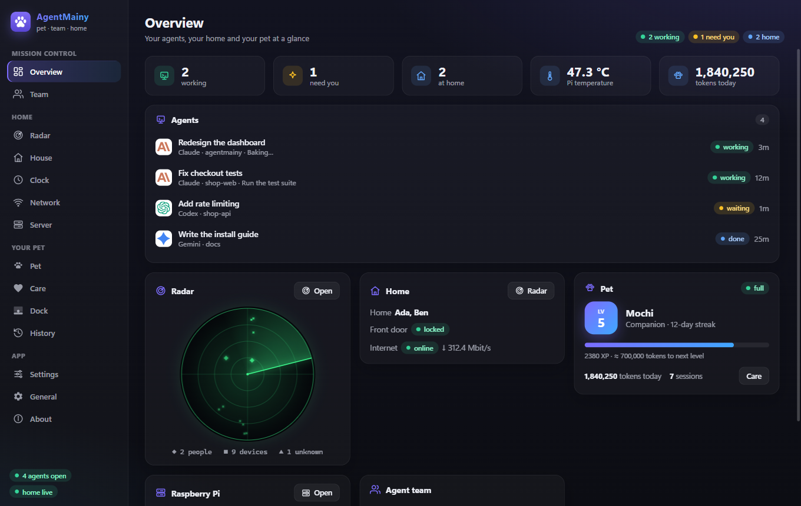
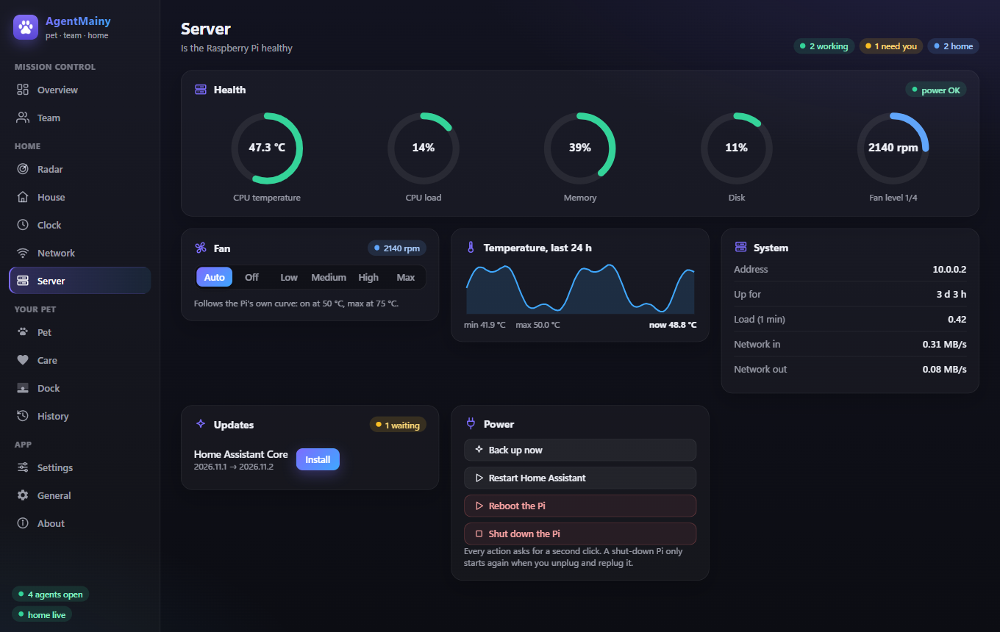
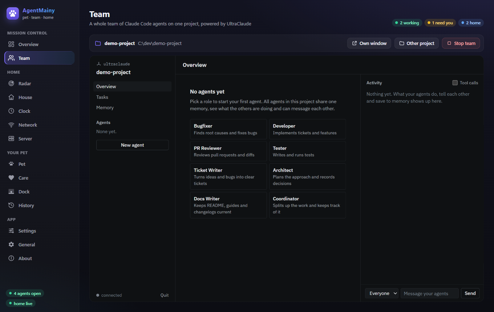
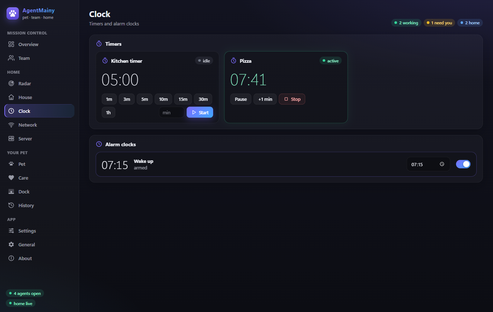
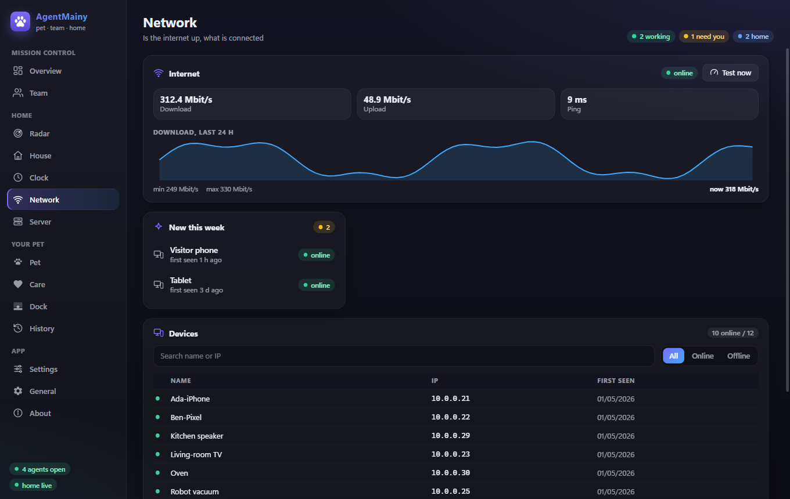
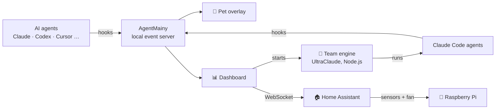

<div align="center">


# AgentMainy

**Your desktop pet, your AI agent team and your home, in one place.**

A pet that lives on your taskbar and reacts live to every AI coding agent you run,
a dashboard that starts a whole **team of Claude Code agents** on any project,
a **presence radar** of your home, and control over the **Raspberry Pi** that runs it.
One small desktop app.

[](LICENSE)
[](#quick-start)
[](https://tauri.app)
[](src)
[](src-tauri)
[](#quick-start)
[](home-assistant)

[Quick start](#quick-start) · [The radar](#-the-radar) · [The dashboard](#the-dashboard) · [How it works](#how-it-works) · [Where everything is](STRUCTURE.md) · [Credits](#credits)

<br />



<sub>The presence radar (demo data): two people home, nine devices, one device the router has never seen.</sub>

</div>

---

## Three apps, one window

<table>
<tr>
<td width="33%" valign="top">

### 🐾 The pet
Floats on your desktop or docks on the taskbar and **reacts in real time** to
Claude Code, Codex, Gemini CLI, Cursor, Copilot, opencode, Windsurf,
Antigravity and Kiro. It **eats the tokens** your agents burn, levels up
through five stages and tells you when an agent **needs you**.

</td>
<td width="33%" valign="top">

### 👥 The team
Start **as many Claude Code agents as you want** on one project. They get
roles (Bugfixer, Developer, Reviewer, Tester, Architect…), share **one
Obsidian memory**, message each other and work off a **task board**, all in
real terminals, right inside the dashboard.

</td>
<td width="33%" valign="top">

### 🏠 The home
Connect **Home Assistant**: a **radar** of who is home, the **door**,
**timers and alarm clocks**, the **internet** and every device on it, and
the **Raspberry Pi** itself, with its temperature and **fan control**.

</td>
</tr>
</table>

## 📡 The radar

A real PPI radar scope for your home. The beam sweeps once per ping
(**every 10 s** by default) and, like an old phosphor screen, every blip
lights up as the beam passes and slowly fades.

- **◆ People** who are home sit on the inner rings, **■ devices** online on
  the outer ones, and a **▲ device the router has never seen** blinks amber
  as *UNKNOWN*.
- Every contact has a fixed **bearing** and **ring**, so it keeps its place
  from scan to scan.
- An **event log** records every contact acquired and lost, even while you
  look at other pages.
- **Active ping** asks the router for a fresh device list on every sweep.
- Optional **sonar ping** sound, four colour themes (phosphor, cyan, amber,
  violet), afterglow length, labels, people-only mode, all in **Settings**.

## The dashboard

Each page answers one question, so nothing is mixed up: a timer is not next
to who is home.

<table>
<tr>
<td width="50%"></td>
<td width="50%"></td>
</tr>
<tr>
<td align="center"><b>Overview</b>: what needs you, at a glance</td>
<td align="center"><b>Server</b>: is the Raspberry Pi healthy?</td>
</tr>
<tr>
<td width="50%"></td>
<td width="50%"></td>
</tr>
<tr>
<td align="center"><b>Team</b>: pick a role, the agent starts in a real terminal</td>
<td align="center"><b>Clock</b>: timers and alarm clocks that run in Home Assistant, even with the app closed</td>
</tr>
<tr>
<td width="50%"></td>
<td width="50%"></td>
</tr>
<tr>
<td align="center"><b>Network</b>: is the internet up, what is connected</td>
<td align="center"><b>Care</b>: your pet eats the tokens your agents burn</td>
</tr>
</table>

| Group | Page | What it answers |
|---|---|---|
| Mission control | **Overview** | Agents working or waiting, people home, Pi temperature, tokens today |
| | **Team** | A team of Claude Code agents on one project (UltraClaude) |
| Home | **Radar** | Who and what is home right now |
| | **House** | Is the door locked, what is running (lock, door sensor, appliances) |
| | **Clock** | Timers with live countdown, alarm clocks you set and arm |
| | **Network** | Internet up and how fast (24 h), every device, new ones flagged |
| | **Server** | The Pi: temperature, CPU, memory, disk, **fan**, updates, restart / reboot / shut down |
| Your pet | **Pet · Care · Dock · History** | Every AgentPet setting, in the new design |
| App | **Settings · General · About** | Home Assistant, radar, server, accent colour, start page; agents and notifications |

Risky actions (unlock the door, reboot or shut down the Pi, install an
update) always need a **second click**.

### Raspberry Pi fan control

On a Raspberry Pi 5 with the official Active Cooler the **Server** page
switches the fan between **Auto** (the Pi's own curve: on at 50 °C, max at
75 °C) and **Off / Low / Medium / High / Max**. A safety floor overrides any
manual choice above 70 °C, so a setting can never let the Pi overheat. The
Home Assistant side is in [`home-assistant/`](home-assistant).

## Quick start

> **Status:** v0.3.0. Builds, all tests pass, runs as the installed app.
> There is no signed installer release yet, so build it yourself (about
> 5 minutes the first time).

**You need:** Windows 10/11 · [Node.js](https://nodejs.org) 20+ · [Rust](https://rustup.rs) ·
[Claude Code](https://claude.com/claude-code) (for the Team) · optionally
[Home Assistant](https://www.home-assistant.io) (for the Home pages).

```bash
git clone https://github.com/ny-daniel-l/AgentMainy.git
cd AgentMainy
npm install
npm run engine:install      # the team engine's own dependencies
npm run tauri dev           # run it
npm run tauri build         # or build the installer (src-tauri/target/release/bundle)
```

Then:

1. **Connect your agents**: **General** → switch on Claude, Codex, Cursor…
2. **Pick a pet**: **Pet** → choose one, browse more or import your own spritesheet.
3. **Start a team**: **Team** → pick a project folder → **Start team** → choose a role.
4. **Connect your home**: **Settings** → your Home Assistant address + a
   [long-lived access token](https://www.home-assistant.io/docs/authentication/#your-account-profile).
5. **Optional extras** (router presence, Pi fan, Nuki, V-ZUG): see [`home-assistant/`](home-assistant).

<details>
<summary><b>Coming from AgentPet?</b></summary>

Your pet, its XP and all settings carry over: AgentMainy keeps AgentPet's app
identifier and settings folder on purpose. On its first start the installed
app **moves your agents' hooks to itself** automatically. An agent session
that was already open keeps its old hook until you restart it (Claude Code
reads hooks when a session starts).

</details>

## How it works



- **Agents → pet.** Each agent's hook runs `AgentMainy.exe hook --agent <kind>`,
  which hands the event to the running app on `127.0.0.1`. It never blocks
  an agent: it always exits 0.
- **Team.** The dashboard starts the bundled
  [UltraClaude](https://github.com/ZH-NICO/ultraclaude) engine for the folder
  you pick. It listens on `127.0.0.1` only, behind a random access token.
  Team agents are normal Claude Code sessions, so the pet watches them too.
- **Home.** The dashboard talks to Home Assistant's WebSocket API with your
  token and follows live state changes. The radar scans on its own clock and
  logs what changed. Nothing goes through a cloud.

Want the full map? **[STRUCTURE.md](STRUCTURE.md)** explains every folder and
file, the atomic design of the dashboard, how the parts talk and where your
data is kept.

<details>
<summary><b>Project layout</b></summary>

```
src/
  overlay/     the pet window, speech bubble, taskbar dock, right-click menu
  pet/         sprite, care engine (XP, levels, hunger), catalog, chatter
  agents/      live sessions, history, token usage
  dashboard/   atoms → molecules → organisms → pages, plus services
  shared/      translations (EN · VI · 简体 · 繁體) and icons
src-tauri/     Rust: windows, tray, hooks, event server, CLI, team launcher
engine/        the team engine (UltraClaude, vendored)
home-assistant/  router presence, Pi fan control, Nuki and V-ZUG extras
tests/         unit tests for the home and radar logic
```

</details>

## Command line

The same program is also a small CLI, handy for scripts and for other agents:

| Command | Does |
|---|---|
| `AgentMainy.exe ls` | every agent the pet sees, with state and activity |
| `AgentMainy.exe peek <agent>` | one agent's state, project, title and activity |
| `AgentMainy.exe wait <agent> [-t SECS]` | wait until it stops working |
| `AgentMainy.exe send <agent> <text>` | type a message into that agent's terminal |
| `AgentMainy.exe run -- <command>` | wrap any CLI agent: working while it runs, done when it exits |

A ready-made Claude Code skill for these lives in [`skill/`](skill/SKILL.md).

## Privacy

- The event server, the team engine and the Home Assistant connection run
  **on your computer** and only use your own machine and your own network.
  Pets are downloaded from AgentPet's public pet catalog, and the pet's idle
  chatter fetches Kanye quotes from [api.kanye.rest](https://api.kanye.rest) once a day.
- Your Home Assistant token is stored in the app on this computer only.
- The optional router script in [`home-assistant/`](home-assistant) keeps the
  router password on your Home Assistant. The app never sees it.
- Optional and off by default: the pet's web profile / leaderboard sync.

## Development

```bash
npm run dev     # the frontend alone (http://localhost:1420)
npm run build   # type-check + bundle
npm test        # TypeScript unit tests + team engine tests + Rust tests
```

The design follows a few rules: one question per page, most important first,
colour only for state and always with a text label, dark surfaces with depth
from lighter layers, and a second click for anything risky.


AgentMainy is an independent project and is not made or endorsed by
Anthropic, Home Assistant, Raspberry Pi or the authors above.

## License

[MIT](LICENSE) © ny-daniel-l, with the original copyrights of AgentPet and UltraClaude.
