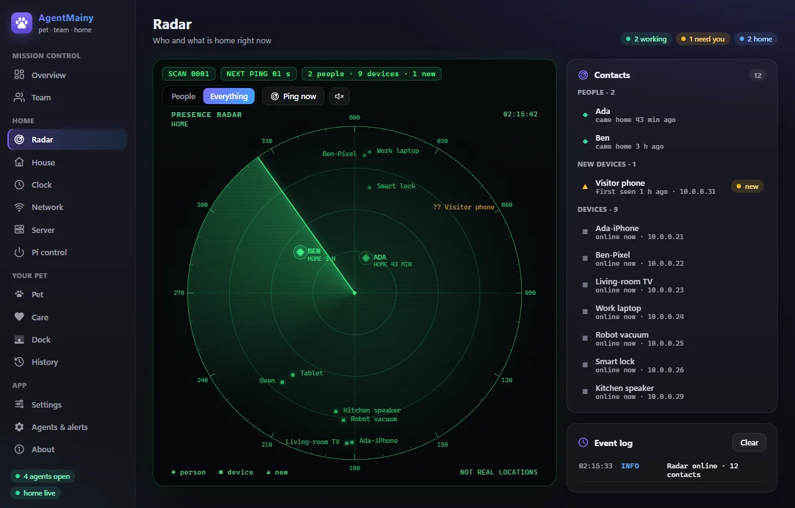
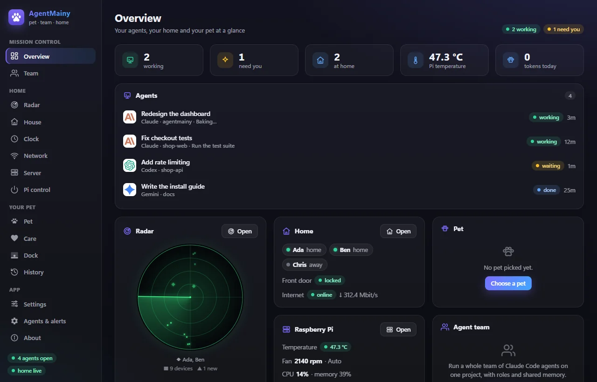
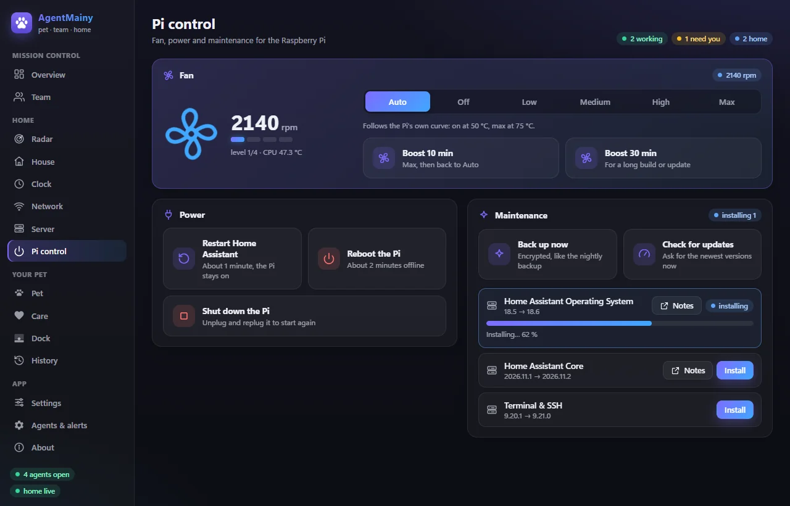
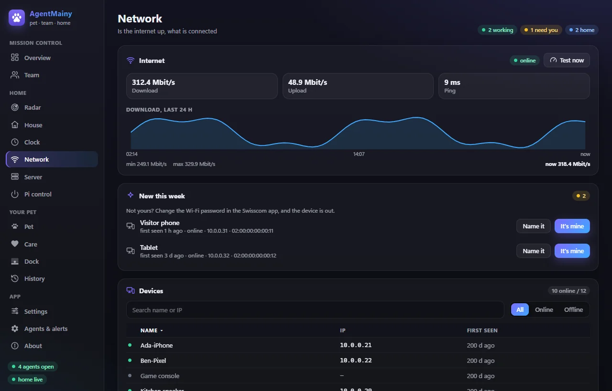
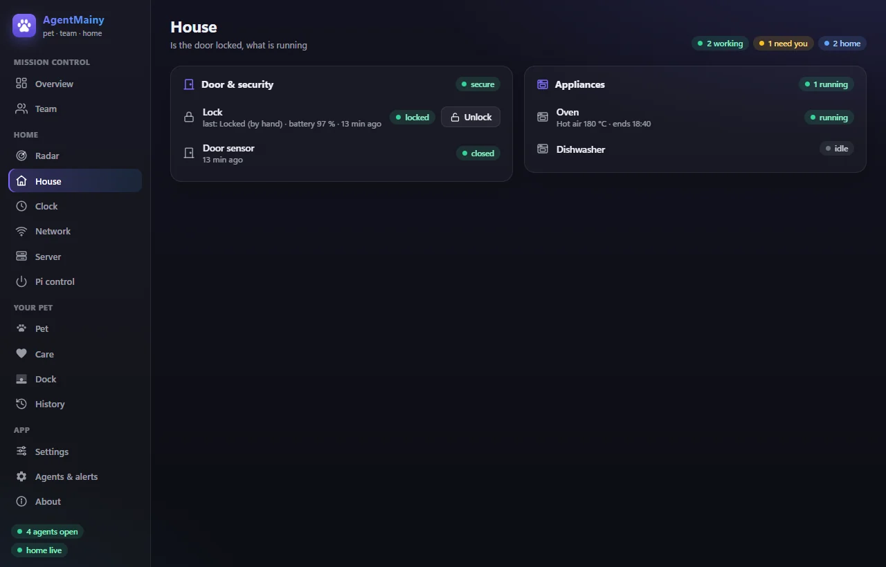
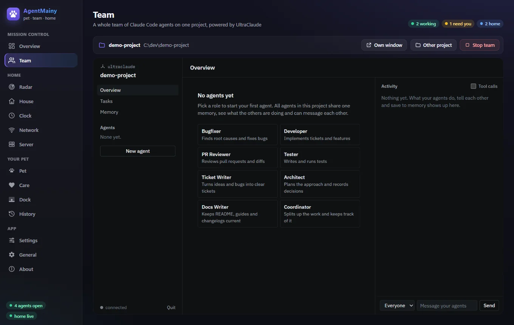
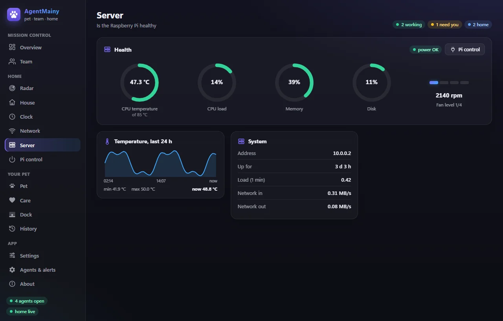
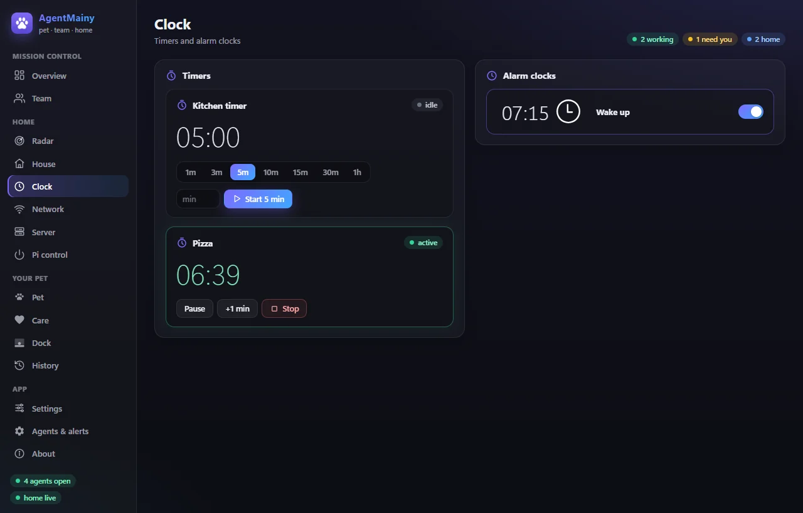
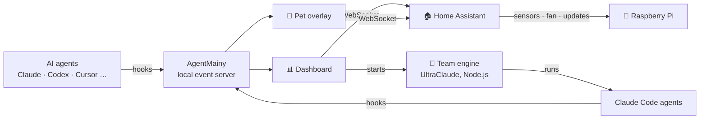

<div align="center">


# AgentMainy

### Your desktop pet, your AI agent team and your home, in one place.

A pet that lives on your taskbar and reacts live to every AI coding agent you run,
a dashboard that starts a whole **team of Claude Code agents** on any project,
a **presence radar** of your home, and control over the **Raspberry Pi** that runs it.

[](#-quick-start)
[](#-quick-start)
[](https://tauri.app)
[](LICENSE)

[](src)
[](src-tauri)
[](home-assistant)
[](#-raspberry-pi-control)
[](#-what-it-does)

[Quick start](#-quick-start) · [Features](#-what-it-does) · [The radar](#-the-radar) · [Pages](#-every-page) · [How it works](#-how-it-works) · [Code map](STRUCTURE.md)

<br />



<sub>The presence radar with demo data: two people home, nine devices online, one device the router has never seen.</sub>

</div>

---

## ✨ What it does

<table>
<tr>
<td width="33%" valign="top">

### 🐾 The pet
Floats on your desktop or docks on the taskbar and **reacts in real time** to
Claude Code, Codex, Gemini CLI, Cursor, Copilot, opencode, Windsurf,
Antigravity and Kiro. It **eats the tokens** your agents burn, levels up
through five stages and tells you when an agent **needs you**.
Hover it for a panel with your usage, limits and a **mini radar of your home**.

</td>
<td width="33%" valign="top">

### 👥 The team
Start **as many Claude Code agents as you want** on one project. They get
roles (Bugfixer, Developer, Tester, Architect, Coordinator…), share **one
Obsidian memory**, message each other and work off a **task board**, all in
real terminals, right inside the dashboard.

</td>
<td width="33%" valign="top">

### 🏠 The home
Connect **Home Assistant**: a **radar** of who is home, the **door**,
**timers and alarm clocks**, the **internet** and every device on it, and
the **Raspberry Pi** itself: its health, **fan control and boost**,
updates with live progress, restart and shutdown.

</td>
</tr>
</table>

<table>
<tr>
<td width="50%"></td>
<td width="50%"></td>
</tr>
<tr>
<td align="center"><b>Overview</b>: what needs you, at a glance</td>
<td align="center"><b>Pi control</b>: fan, power and updates for the Raspberry Pi</td>
</tr>
</table>

## 📡 The radar

A PPI radar scope for your home. The beam sweeps once per ping (**every 10 s**
by default) and, like an old phosphor screen, every blip lights up as the beam
passes and slowly fades.

- **◆ People** who are home sit on the inner rings, **■ devices** that are
  online on the outer ones, and a **▲ new device** (one the router saw for the
  first time today) blinks amber.
- The radar knows **who** is home, not **where**: each contact keeps a fixed
  spot, and the scope says so (*not real locations*).
- The contact list says what matters: *came home 43 min ago*, *online now ·
  10.0.0.21*, *first seen 1 h ago*.
- An **event log** records every contact that appears or disappears, even
  while you look at other pages.
- **Active ping** asks the router for a fresh device list on each sweep, but
  only while a radar is on screen and the window has focus.
- Optional **sonar ping** sound, four colours (phosphor, cyan, amber, violet),
  afterglow length, labels and a people-only mode, all in **Settings**.

## 🗂 Every page

Each page answers one question, so nothing is mixed up: a timer is not next to
who is home.

| | Page | What it answers |
|---|---|---|
| 🧭 | **Overview** | Agents working or waiting, who is home (and since when), Pi temperature, tokens today |
| 👥 | **Team** | A team of Claude Code agents on one project, powered by UltraClaude |
| 📡 | **Radar** | Who and what is home right now |
| 🚪 | **House** | Is the door locked **and** closed, what is running (lock, door sensor, appliances) |
| ⏰ | **Clock** | Timers with a live countdown, alarm clocks you set and arm |
| 🌐 | **Network** | Internet up and how fast (24 h chart), every device: **rename** it, mark new ones as **yours** |
| 🖥 | **Server** | Is the Pi healthy: temperature, CPU, memory, disk, fan, 24 h temperature |
| ⚡ | **Pi control** | Fan modes and **boost**, restart Home Assistant, **reboot / shut down**, backup, **updates with progress** |
| 🐾 | **Pet · Care · Dock · History** | Pick or import a pet, its level and token burn, the dock and speech bubble, past sessions |
| ⚙️ | **Settings · Agents & alerts · About** | Home Assistant, radar, look and start page · agent hooks, notifications, sounds, language |

<table>
<tr>
<td width="50%"></td>
<td width="50%"></td>
</tr>
<tr>
<td align="center"><b>Network</b>: is the internet up, what is connected</td>
<td align="center"><b>House</b>: <i>secure</i> only when locked and closed</td>
</tr>
<tr>
<td width="50%"></td>
<td width="50%"></td>
</tr>
<tr>
<td align="center"><b>Team</b>: pick a role, the agent starts in a real terminal</td>
<td align="center"><b>Server</b>: is the Raspberry Pi healthy?</td>
</tr>
<tr>
<td width="50%"></td>
<td width="50%" valign="middle">

**Built to be calm and safe**

- Pages update **in place**: live values never make the screen flash.
- Risky actions (unlock the door, reboot, install an update) need a
  **second click**. Shutting the Pi down **while you're away** needs a
  3-second hold, because nobody could switch it back on.
- Colour always comes with a word: *locked*, *online*, *new*.
- Visible focus rings and named sidebar tabs for keyboard and screen-reader users.

</td>
</tr>
<tr>
<td align="center"><b>Clock</b>: timers and alarms that run in Home Assistant, even with the app closed</td>
<td></td>
</tr>
</table>

## 🍓 Raspberry Pi control

On a Raspberry Pi 5 with the official Active Cooler, **Pi control** switches
the fan between **Auto** (the Pi's own curve: on at 50 °C, full at 75 °C) and
**Off / Low / Medium / High / Max**, or **boosts** it to full speed for 10 or
30 minutes and then back to Auto by itself. Picking any mode ends a boost. A
safety floor overrides any manual choice above 70 °C, so a setting can never
let the Pi overheat.

Updates for Home Assistant, the OS and add-ons show **installed → latest**,
release notes, and a **progress bar** while they install, even across the
restart a Core update needs. The Home Assistant side is in
[`home-assistant/`](home-assistant).

## 🚀 Quick start

> **Status:** v0.3.0. Builds, all tests pass, runs as the installed app.
> There is no signed installer release yet, so build it yourself (about
> 5 minutes the first time).

<details open>
<summary><b>1 · Install</b></summary>

**You need:** Windows 10/11 · [Node.js](https://nodejs.org) 20+ · [Rust](https://rustup.rs) ·
[Claude Code](https://claude.com/claude-code) (for the Team) · optionally
[Home Assistant](https://www.home-assistant.io) (for the Home pages).

```bash
git clone https://github.com/ny-daniel-l/AgentMainy.git
cd AgentMainy
npm install
npm run engine:install      # the team engine's own dependencies
npm run tauri dev           # run it
npm run tauri build         # or build the installer (src-tauri/target/release/bundle)
```

Then:

1. **Connect your agents**: **Agents & alerts** → switch on Claude, Codex, Cursor…
2. **Pick a pet**: **Pet** → choose one, browse more or import your own spritesheet.
3. **Start a team**: **Team** → pick a project folder → **Start team** → choose a role.

</details>

<details>
<summary><b>2 · Connect Home Assistant</b></summary>

Open **Settings** and enter your Home Assistant address and a
[long-lived access token](https://www.home-assistant.io/docs/authentication/#your-account-profile)
(your profile → Security → Long-lived access tokens).

The address field takes **several addresses**, separated by commas. They are
tried in order and the first that answers is used. You can change the
address later without entering the token again.

The token stays in the app on this computer and is only sent to your own
Home Assistant.

</details>

<details>
<summary><b>3 · Optional: the Home Assistant kit</b></summary>

The Home pages find people, locks, door sensors, the internet speed test,
timers and appliances on their own. The kit in
[`home-assistant/`](home-assistant) adds the extras:

- **Who is home** from the phones on your Wi-Fi, no app on the phone. A phone
  counts as away only after 10 minutes off the Wi-Fi, because a locked iPhone
  drops off now and then.
- A **new device** alert, the **Nuki** door lock over MQTT, a **V-ZUG**
  appliance.
- **Raspberry Pi 5 fan control** with the safety floor.
- A router script for the **Swisscom Internet-Box**.

See [`home-assistant/README.md`](home-assistant/README.md) for the steps.

</details>

<details>
<summary><b>4 · Optional: your home from anywhere (Tailscale)</b></summary>

Away from home the Pi's address doesn't exist. [Tailscale](https://tailscale.com)
fixes that **without opening anything to the internet**:

1. Install Tailscale on the laptop and sign in.
2. On the Pi, install the [Tailscale add-on](https://github.com/hassio-addons/addon-tailscale)
   and sign it in to the same account.
3. In **Settings**, enter both addresses, Tailscale first:
   `http://homeassistant:8123, http://<home address>:8123`.

Away, the app uses Tailscale. At home it also works if Tailscale is off. When
the app reaches the Pi over Tailscale, shutting the Pi down needs a 3-second
hold.

</details>

<details>
<summary><b>Coming from AgentPet?</b></summary>

Your pet, its XP and all settings carry over: AgentMainy keeps AgentPet's app
identifier and settings folder on purpose. On its first start the installed
app **moves your agents' hooks to itself** automatically. An agent session
that was already open keeps its old hook until you restart it (Claude Code
reads hooks when a session starts).

</details>

## 🧩 How it works



- **Agents → pet.** Each agent's hook runs `AgentMainy.exe hook --agent <kind>`,
  which hands the event to the running app on `127.0.0.1`. It never blocks
  an agent: it always exits 0.
- **Team.** The dashboard starts the bundled
  [UltraClaude](https://github.com/ZH-NICO/ultraclaude) engine for the folder
  you pick. It listens on `127.0.0.1` only, behind a random access token, and
  is started again by itself if it stopped (say, after the laptop slept).
  Team agents are normal Claude Code sessions, so the pet watches them too.
- **Home.** The dashboard and the pet's panel talk to Home Assistant's
  WebSocket API with your token and follow live state changes. "Since when"
  times come from Home Assistant's history, so a restart doesn't reset them.
  Nothing goes through a cloud.

Want the full map? **[STRUCTURE.md](STRUCTURE.md)** explains every folder and
file, the atomic design of the dashboard, how the parts talk and where your
data is kept.

<details>
<summary><b>Project layout</b></summary>

```
src/
  overlay/     the pet window, speech bubble, taskbar dock and its Home card
  pet/         sprite, care engine (XP, levels, hunger), catalog, chatter
  agents/      live sessions, history, token usage
  dashboard/   atoms → molecules → organisms → pages, plus services
  shared/      translations (EN · VI · 简体 · 繁體) and icons
src-tauri/     Rust: windows, tray, hooks, event server, CLI, team launcher
engine/        the team engine (UltraClaude, vendored)
home-assistant/  router presence, Pi fan control, Nuki and V-ZUG extras
tests/         unit tests for the home, presence and radar logic
```

</details>

## ⌨️ Command line

The same program is also a small CLI, handy for scripts and for other agents:

| Command | Does |
|---|---|
| `AgentMainy.exe ls` | every agent the pet sees, with state and activity |
| `AgentMainy.exe peek <agent>` | one agent's state, project, title and activity |
| `AgentMainy.exe wait <agent> [-t SECS]` | wait until it stops working |
| `AgentMainy.exe send <agent> <text>` | type a message into that agent's terminal |
| `AgentMainy.exe run -- <command>` | wrap any CLI agent: working while it runs, done when it exits |

A ready-made Claude Code skill for these lives in [`skill/`](skill/SKILL.md).

## 🔒 Privacy

- The event server, the team engine and the Home Assistant connection run
  **on your computer** and only use your own machine and your own network.
  Pets are downloaded from AgentPet's public pet catalog, and the pet's idle
  chatter fetches Kanye quotes from [api.kanye.rest](https://api.kanye.rest) once a day.
- Your Home Assistant token and your own device names are stored in the app
  on this computer only.
- The optional router script in [`home-assistant/`](home-assistant) keeps the
  router password on your Home Assistant. The app never sees it.
- Optional and off by default: the pet's web profile / leaderboard sync.
- Every screenshot in this README uses demo data.

## 🛠 Development

```bash
npm run dev     # the frontend alone (http://localhost:1420)
npm run build   # type-check + bundle
npm test        # TypeScript unit tests + team engine tests + Rust tests
```

The design follows a few rules: one question per page, most important first,
colour only for state and always with a text label, dark surfaces with depth
from lighter layers, and a second click for anything risky.

AgentMainy is an independent project and is not made or endorsed by
Anthropic, Home Assistant or Raspberry Pi.

## 📄 License

[MIT](LICENSE) © ny-daniel-l, with the original copyrights of AgentPet and UltraClaude.
