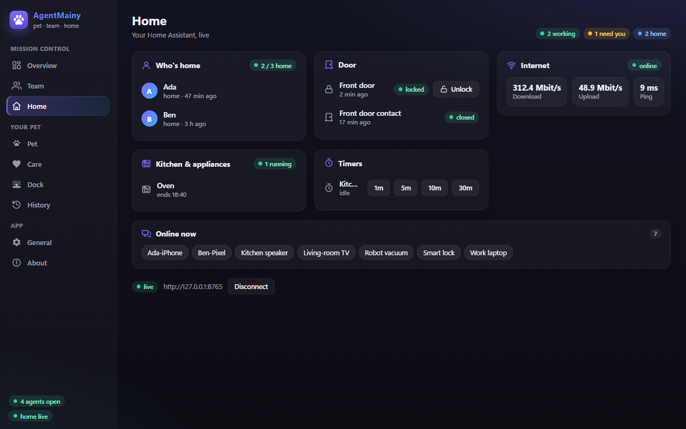
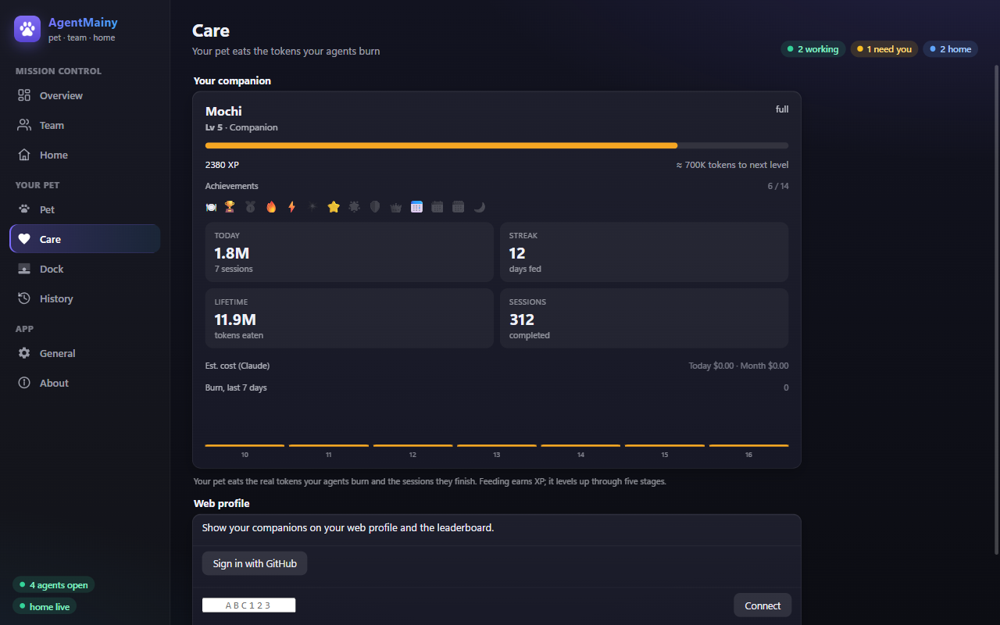
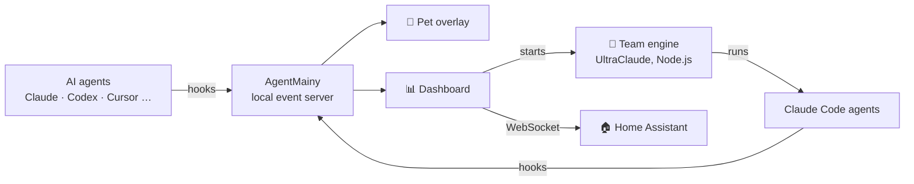

<div align="center">


# AgentMainy

**Your desktop pet, your AI agent team and your home, in one place.**

A pet that lives on your taskbar and reacts live to every AI coding agent you run,
a dashboard that starts a whole **team of Claude Code agents** on any project,
and a live view of your **Home Assistant** home, all in one small desktop app.

[](LICENSE)
[](https://tauri.app)
[](src)
[](src-tauri)
[](#quick-start)
[](home-assistant)

[Quick start](#quick-start) · [What you get](#what-you-get) · [How it works](#how-it-works) · [Where everything is](STRUCTURE.md) · [Credits](#credits)

<br />


<sub>The Overview with demo data: four agents at work, the pet at level 5, two people home.</sub>

</div>

---

## Three apps, one window

<table>
<tr>
<td width="33%" valign="top">

### 🐾 The pet
Floats on your desktop or docks on the taskbar and **reacts in real time** to
Claude Code, Codex, Gemini CLI, Cursor, Copilot, opencode, Windsurf,
Antigravity and Kiro. It **eats the tokens** your agents burn, levels up
through five stages and tells you when an agent **needs you**.

</td>
<td width="33%" valign="top">

### 👥 The team
Start **as many Claude Code agents as you want** on one project. They get
roles (Bugfixer, Developer, Reviewer, Tester, Architect…), share **one
Obsidian memory**, message each other and work off a **task board**, all in
real terminals, right inside the dashboard.

</td>
<td width="33%" valign="top">

### 🏠 The home
Connect **Home Assistant** and see **who is home**, lock or unlock the
**door**, check the **internet**, see which **appliances** are running, start
**timers** and list the **devices online**, live, without opening another
app.

</td>
</tr>
</table>

## What you get

<table>
<tr>
<td width="50%"></td>
<td width="50%"></td>
</tr>
<tr>
<td align="center"><b>Team</b>: pick a role, the agent starts in a real terminal</td>
<td align="center"><b>Home</b>: only what is there right now, updated live</td>
</tr>
<tr>
<td width="50%"></td>
<td width="50%" valign="top">

**The dashboard**

- **Overview**: working / waiting agents, people home, tokens today, the
  pet's level and your team, at a glance.
- **Team**: suggests the folders your agents already work in, keeps running
  while you look at other pages, opens in its own window on demand.
- **Home**: finds everything by itself, no entity ids to configure. Risky
  actions (unlock) need a second click.
- **Pet, Care, Dock, History, General, About**: every AgentPet setting, in
  the new design.
- Click any agent to **jump to its terminal**.

</td>
</tr>
</table>

## Quick start

> **Status:** v0.2.0 builds and all tests pass. There is no signed installer
> release yet, so build it yourself (about 5 minutes the first time).

**You need:** Windows 10/11 · [Node.js](https://nodejs.org) 20+ · [Rust](https://rustup.rs) ·
[Claude Code](https://claude.com/claude-code) (for the Team) · optionally
[Home Assistant](https://www.home-assistant.io) (for the Home page).

```bash
git clone https://github.com/ny-daniel-l/AgentMainy.git
cd AgentMainy
npm install
npm run engine:install      # the team engine's own dependencies
npm run tauri dev           # run it
npm run tauri build         # or build the installer (src-tauri/target/release/bundle)
```

Then:

1. **Connect your agents**: Dashboard → **General** → switch on Claude, Codex, Cursor…
2. **Pick a pet**: **Pet** → choose one, browse more or import your own spritesheet.
3. **Start a team**: **Team** → pick a project folder → **Start team** → choose a role.
4. **Connect your home**: **Home** → your Home Assistant address + a
   [long-lived access token](https://www.home-assistant.io/docs/authentication/#your-account-profile).

<details>
<summary><b>Coming from AgentPet?</b></summary>

Your pet, its XP and all settings carry over: AgentMainy keeps AgentPet's app
identifier and settings folder on purpose. After installing, open
**General** and switch each agent off and on once, so its hook points to
`AgentMainy.exe`.

</details>

## How it works



- **Agents → pet.** Each agent's hook runs `agentpet hook --agent <kind>`,
  which hands the event to the running app on `127.0.0.1`. It never blocks
  an agent: it always exits 0.
- **Team.** The dashboard starts the bundled
  [UltraClaude](https://github.com/ZH-NICO/ultraclaude) engine for the folder
  you pick. It listens on `127.0.0.1` only, behind a random access token.
  Team agents are normal Claude Code sessions, so the pet watches them too.
- **Home.** The dashboard talks to Home Assistant's WebSocket API with your
  token, then follows live state changes. Nothing goes through a cloud.

Want the full map? **[STRUCTURE.md](STRUCTURE.md)** explains every folder and
file, how the parts talk and where your data is kept.

<details>
<summary><b>Project layout</b></summary>

```
src/
  overlay/     the pet window, speech bubble, taskbar dock, right-click menu
  pet/         sprite, care engine (XP, levels, hunger), catalog, chatter
  agents/      live sessions, history, token usage
  dashboard/   atoms → molecules → organisms → pages, plus services
  shared/      translations (EN · VI · 简体 · 繁體) and icons
src-tauri/     Rust: windows, tray, hooks, event server, CLI, team launcher
engine/        the team engine (UltraClaude, vendored)
home-assistant/  optional presence / Nuki / V-ZUG extras for Home Assistant
```

</details>

## Command line

The same program is also a small CLI, handy for scripts and for other agents:

| Command | Does |
|---|---|
| `agentpet ls` | every agent the pet sees, with state and activity |
| `agentpet peek <agent>` | one agent's state, project, title and activity |
| `agentpet wait <agent> [-t SECS]` | wait until it stops working |
| `agentpet send <agent> <text>` | type a message into that agent's terminal |
| `agentpet run -- <command>` | wrap any CLI agent: working while it runs, done when it exits |

A ready-made Claude Code skill for these lives in [`skill/`](skill/SKILL.md).

## Privacy

- The event server, the team engine and the Home Assistant connection run
  **on your computer** and only use your own machine and your own network.
  Pets are downloaded from AgentPet's public pet catalog, and the pet's idle
  chatter fetches Kanye quotes from [api.kanye.rest](https://api.kanye.rest) once a day.
- Your Home Assistant token is stored in the app on this computer only.
- The optional router script in [`home-assistant/`](home-assistant) keeps the
  router password on your Home Assistant. The app never sees it.
- Optional and off by default: the pet's web profile / leaderboard sync.

## Development

```bash
npm run dev     # the frontend alone (http://localhost:1420)
npm run build   # type-check + bundle
npm test        # TypeScript unit tests + team engine tests + Rust tests
```


AgentMainy is an independent project and is not made or endorsed by
Anthropic, Home Assistant or the authors above.

## License

[MIT](LICENSE) © ny-daniel-l, with the original copyrights of AgentPet and UltraClaude.
